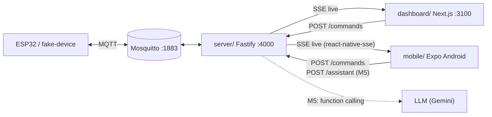

# 01. Kiến trúc

## 1. Mobile nằm ở đâu trong hệ thống



Mobile là **client thứ hai** của backend, ngang hàng với dashboard và dùng đúng API của dashboard. Đến M4, server
**không cần đổi code**, chỉ đổi cấu hình (`HOST=0.0.0.0`, xem §7). M5 thêm một endpoint `/assistant`.

## 2. Stack

Phiên bản lấy theo request-app (`/Users/kb/Documents/works/amrou/request-app/apps/mobile/package.json`).
Khi cài, dùng `npx expo install <pkg>` để Expo chọn version khớp SDK; không gõ version tay cho package của Expo.

| Mảng | Package | Ghi chú |
|---|---|---|
| Runtime | `expo ~55`, `react-native 0.83`, `react 19.2.0` | New Architecture (mặc định SDK 55) |
| Router | `expo-router ~55` | File-based, typed routes |
| Dev | `expo-dev-client` | Bắt buộc từ M5 (`expo-speech-recognition` là native); dùng ngay từ M1 cho đồng nhất |
| Styling | `nativewind ^4`, `tailwindcss ~3.4` | Giống request-app (NativeWind v4 + Tailwind 3) |
| State | `jotai ^2`, `jotai-family` | Không dùng React Query (D6) |
| Lưu máy | `react-native-mmkv` | Settings (URL backend, mã thiết bị, theme, voice) |
| Realtime | `react-native-sse` | `EventSource` cho RN (D7) |
| Đồ hoạ | `react-native-svg`, `d3-shape`, `d3-scale` | Room twin, chart |
| Animation | `react-native-reanimated ~4`, `react-native-worklets`, `react-native-gesture-handler` | Animation cửa sổ, chart scrub, slider |
| UI hệ thống | `react-native-safe-area-context`, `react-native-screens`, `expo-status-bar`, `expo-system-ui`, `expo-splash-screen` | |
| Cảm giác | `expo-haptics`, `expo-linear-gradient`, `expo-image`, `expo-blur` (tuỳ chọn) | |
| Font | `expo-font` + `@expo-google-fonts/nunito-sans` | Xem `03-design-system.md` §3 |
| Icon | `lucide-react-native` | Cùng bộ với dashboard |
| Bottom sheet | `@gorhom/bottom-sheet ^5` | Voice sheet, chọn thiết bị |
| Cấu hình build | `expo-build-properties`, `expo-constants` | Cleartext HTTP cho Android (§7) |
| Voice (M5) | `expo-speech-recognition`, `expo-speech` | STT trên máy + TTS |
| Shared | `@srdt/contracts`, `@srdt/twin-core` (`workspace:*`) | |

Không dùng: React Query, form library (app không có form phức tạp), i18n library (D14), Firebase.

## 3. `packages/twin-core` (D10)

Package TypeScript thuần (không React, không DOM, không RN) để dashboard và mobile cùng import.

```
packages/twin-core/
├─ package.json          name @srdt/twin-core, exports "./src/index.ts", deps: @srdt/contracts
├─ src/
│  ├─ index.ts
│  ├─ twin-state.ts      TwinState, initialTwinState, applyMessage(), HISTORY_MS, LIST_SIZE, latest()
│  ├─ thresholds.ts      TEMP_LINES, HUMIDITY_LINES, AQ_LINES, levelFor()   ← chuyển từ dashboard/src/lib/thresholds.ts
│  ├─ format.ts          STATE_LABEL, fmt, ago, countdown, clockTime, toMs, windowLabel  ← từ dashboard/src/lib/format.ts
│  ├─ commands.ts        ACTION_LABEL, actionGroup, conflicts, isOpenStatus, resultText, apiErrorText
│  ├─ derive.ts          deriveRoomView(): online, stale, windowAngle, buzzer, override, lastSeenAt
│  └─ source.ts          ConnectionState, TwinHandlers, TwinSource  ← từ dashboard/src/lib/datasource/types.ts
└─ test/                 vitest: applyMessage, levelFor, conflicts, deriveRoomView, countdown/ago
```

Những gì **không** vào twin-core: `STATE_COLOR` (dashboard dùng biến CSS, mobile dùng token hex), mọi component,
implementation của `TwinSource` (EventSource của trình duyệt ≠ `react-native-sse`).

`applyMessage(state, msg, at)` chính là hàm `reduce` trong `dashboard/src/hooks/useTwin.ts` (nhánh `message`), tách
ra để thuần. Các nhánh `connection`/`error` ở lại trong từng app vì mỗi app giữ trạng thái kết nối khác nhau.

`deriveRoomView(device, latest, lastTelemetryAt, now)` gom logic đang nằm rải rác trong `Dashboard.tsx`:

```ts
interface RoomView {
  online: boolean;                    // device.presence === "online"
  lastSeenAt: number | null;          // max(lastTelemetryAt, device.lastSeenAt), theo giờ nhận
  stale: boolean;                     // online && now - lastTelemetryAt > STALE_AFTER_MS (15 s)
  edgeState: EdgeState | null;        // latest?.edgeState ?? device.edgeState
  windowAngle: number | null;         // reported.actuators ?? latest
  buzzer: boolean | null;
  override: ReportedState["override"] | undefined;
  mlState: EdgeState | null | undefined; // undefined = thiết bị không gửi
  aiControl: boolean;
}
```

**Migration cho dashboard** (một commit riêng, trước khi code mobile): đổi import sang `@srdt/twin-core`, xoá
`thresholds.ts`, phần thuần của `format.ts`, `datasource/types.ts`; `useTwin` gọi `applyMessage`. Hành vi dashboard
giữ nguyên, kiểm bằng `pnpm --filter @srdt/dashboard typecheck` + `build` + mở thử.

`twin-core` export file `.ts` nguồn (giống `@srdt/contracts`: `"exports": { ".": "./src/index.ts" }`), không có
bước build. `dashboard/next.config.ts` phải thêm `"@srdt/twin-core"` vào `transpilePackages` (đang chỉ có
`@srdt/contracts`). Import nội bộ trong twin-core **không** dùng đuôi `.js` (giống contracts), để Metro resolve
thẳng, không cần hack như `metro.config.js` của request-app.

## 4. Cấu trúc thư mục `mobile/`

Quy ước giống request-app: tên file kebab-case, mỗi feature một thư mục, atom trong `_atoms/`.

```
mobile/
├─ README.md
├─ specs/                         bộ spec này
├─ package.json                   @srdt/mobile
├─ app.config.ts                  tên app, package id, plugins, extra (§6)
├─ eas.json                       profile development / preview (APK)
├─ metro.config.js                monorepo + NativeWind (§5)
├─ babel.config.js                babel-preset-expo (jsxImportSource nativewind) + worklets plugin
├─ tailwind.config.js             map tokens.js → Tailwind
├─ global.css                     @tailwind base/components/utilities
├─ nativewind-env.d.ts
├─ tsconfig.json                  extends expo/tsconfig.base, strict, noUncheckedIndexedAccess, alias @/*
├─ .env.example                   EXPO_PUBLIC_API_BASE_URL, EXPO_PUBLIC_DEVICE_CODE
├─ assets/
│  ├─ images/icon.png, adaptive-icon.png, splash-icon.png
│  └─ images/room-interior.jpg    copy từ dashboard/public/images (giữ CREDITS)
└─ src/
   ├─ app/
   │  ├─ _layout.tsx              providers (Jotai, GestureHandler, SafeArea, BottomSheet, Theme), font, splash, TwinStream
   │  ├─ (tabs)/
   │  │  ├─ _layout.tsx           tab bar 4 tab + nút mic (M5)
   │  │  ├─ index.tsx             Home
   │  │  ├─ trends.tsx
   │  │  ├─ controls.tsx
   │  │  └─ activity.tsx
   │  ├─ settings.tsx             push từ header
   │  └─ voice.tsx                modal (M5)
   ├─ features/
   │  ├─ twin/
   │  │  ├─ _atoms/state.ts       atom gốc của twin (02-data-layer §3)
   │  │  ├─ _atoms/derived.ts     atom suy ra (latest, roomView…)
   │  │  ├─ twin-stream.tsx       component không UI: mở/đóng SSE theo settings + AppState
   │  │  └─ components/           room-hero, room-twin-svg, status-card, metric-card, metric-grid, presence-badge, connection-gate, connection-banner
   │  ├─ trends/components/       trend-chart, series-switch, trend-summary
   │  ├─ controls/
   │  │  ├─ _atoms/mutations.ts   sendCommandAtom
   │  │  ├─ _atoms/ui.ts          requestingAtom, busyFamily
   │  │  └─ components/           window-card, angle-dial, alarm-card, auto-control-card, command-history, quick-actions
   │  ├─ activity/components/     event-row, command-row, activity-switch
   │  ├─ settings/
   │  │  ├─ _atoms/settings.ts    atomWithStorage (MMKV)
   │  │  └─ components/           backend-field, device-picker, health-check, theme-picker
   │  └─ voice/                   (M5) _atoms, components (voice-sheet, waveform, result-card)
   ├─ components/                 dùng chung: screen, text, card, button, icon-button, badge, pill, segmented-control, section-header, empty-state, toast-host, hairline
   └─ lib/
      ├─ api/client.ts            fetch + ApiError + timeout
      ├─ api/endpoints.ts         sendCommand, getHealth, listDevices, (M5) askAssistant
      ├─ datasource/rn-sse.ts     TwinSource dùng react-native-sse
      ├─ storage/mmkv.ts          instance MMKV + adapter cho atomWithStorage
      ├─ theme/tokens.js          CommonJS, nguồn duy nhất của màu/chữ (03-design-system)
      ├─ theme/colors.ts          re-export cho code TS (SVG, chart cần hex)
      ├─ theme/use-theme.ts       scheme hiện tại (system/light/dark)
      ├─ haptics.ts               map sự kiện → kiểu rung
      ├─ toast.ts                 toastAtom + pushToast
      └─ hooks/use-now.ts         đồng hồ theo chu kỳ (1 s / 5 s), port từ dashboard
```

## 5. Monorepo: Metro + pnpm

Khác request-app: root của repo này **không** cài `react`/`react-native` (dashboard dùng React 19.3, mobile dùng
19.2; pnpm cài riêng cho từng package). Vì vậy React singleton phải trỏ vào `mobile/node_modules`, không phải root.

```js
// mobile/metro.config.js (phác thảo)
const path = require("node:path");
const { getDefaultConfig } = require("expo/metro-config");
const { withNativeWind } = require("nativewind/metro");

const projectRoot = __dirname;
const workspaceRoot = path.resolve(projectRoot, "..");
const config = getDefaultConfig(projectRoot);

config.watchFolders = [path.resolve(workspaceRoot, "packages"), path.resolve(workspaceRoot, "node_modules")];
config.resolver.nodeModulesPaths = [
  path.resolve(projectRoot, "node_modules"),
  path.resolve(workspaceRoot, "node_modules"),
];
config.resolver.disableHierarchicalLookup = true;
config.resolver.extraNodeModules = {
  react: path.resolve(projectRoot, "node_modules/react"),
  "react-native": path.resolve(projectRoot, "node_modules/react-native"),
};
config.resolver.blockList = [/packages\/.*\/node_modules\/.*/, /dashboard\/.*/, /server\/.*/];

module.exports = withNativeWind(config, { input: "./global.css" });
```

Hệ quả cần nhớ:

- `@srdt/contracts` và `@srdt/twin-core` import `zod`. Vì `disableHierarchicalLookup`, `zod` phải resolve được từ
  `mobile/node_modules` → thêm `zod` vào dependencies của mobile (cùng major 3 với contracts).
- `pnpm-workspace.yaml` thêm `mobile`. Nếu Expo autolinking không thấy native module do symlink của pnpm, thêm
  `.npmrc` ở root `node-linker=hoisted` **chỉ khi thật sự cần** (ảnh hưởng cả repo, phải hỏi trước). Request-app chạy
  được với pnpm mặc định, nên thử mặc định trước.
- Root `package.json` thêm script: `mobile` (`expo start --dev-client`), `mobile:android` (`expo run:android`),
  `mobile:typecheck`.
- `pnpm -r typecheck` sẽ chạy cả mobile (`tsc --noEmit`). Mobile dùng TypeScript `~5.9` theo Expo; contracts/server
  đang dùng TS 7, không xung đột vì mỗi package tự có `typescript`.

## 6. `app.config.ts`

| Khoá | Giá trị |
|---|---|
| `name` | `Smart Room` (dev build: `Smart Room (Dev)`) |
| `slug` / `scheme` | `smart-room` / `smartroom` |
| `android.package` | `dev.srdt.smartroom` (dev build thêm `.dev`) |
| `orientation` | `portrait` |
| `userInterfaceStyle` | `automatic` |
| `android.edgeToEdgeEnabled` | `true` (mặc định SDK 55) |
| `android.permissions` | `INTERNET`; M5 thêm `RECORD_AUDIO` |
| `plugins` | `expo-router`, `expo-font`, `expo-splash-screen` (nền `#f6f7f4`, dark `#19211d`), `expo-build-properties` (§7), M5: `expo-speech-recognition` (chuỗi xin quyền micro) |
| `extra` | `apiBaseUrl`, `deviceCode` mặc định từ `EXPO_PUBLIC_API_BASE_URL` (không đặt → dev dùng host của Metro `:4000`, xem `settings.ts`; fallback `http://10.0.2.2:4000`), `EXPO_PUBLIC_DEVICE_CODE` (mặc định `room-01`) |
| `experiments.typedRoutes` | `true` |

Icon: chữ house của dashboard (brand-mark), nền accent `#527562`, glyph trắng. Adaptive icon: foreground glyph,
background `#527562`.

## 7. Mạng khi dev

| Chạy app trên | URL backend | Cần làm ở server |
|---|---|---|
| Android emulator | `http://10.0.2.2:4000` | Không cần gì (`10.0.2.2` = `127.0.0.1` của máy host) |
| Điện thoại thật, cùng Wi-Fi | `http://<IP LAN của máy chạy server>:4000` | `HOST=0.0.0.0` trong `server/.env`; mở firewall cổng 4000 |
| Điện thoại thật, cắm USB | `http://127.0.0.1:4000` + `adb reverse tcp:4000 tcp:4000` | Không cần gì |

- Android chặn HTTP thường từ API 28: bật `usesCleartextTraffic: true` qua `expo-build-properties` (chỉ dev/preview;
  khi có backend HTTPS ở cloud thì tắt cho production).
- CORS không ảnh hưởng app native (request không có header `Origin`; route SSE chỉ thêm `access-control-allow-origin`
  khi có `Origin`, xem `server/src/api/routes.ts`).
- Không có auth (giống dashboard, `docs/architecture.md` §2). Ai biết URL trong LAN là điều khiển được. Ghi nhận,
  chưa xử lý trong phạm vi này.

## 8. Build & phân phối

| Profile `eas.json` | Dùng khi | Lệnh |
|---|---|---|
| `development` | Dev client, debug, kết nối Metro | `pnpm mobile:android` (local, cần Android SDK) hoặc `eas build --profile development --platform android` |
| `preview` | APK cài thử, gửi thầy/nhóm | `eas build --local --profile preview --platform android` → `.apk` |

Không có `production`/store trong phạm vi project môn học. Không dùng EAS Update (OTA).

`android/` sinh bởi `expo prebuild`, **không commit** (thêm vào `mobile/.gitignore`); mọi thay đổi native qua
`app.config.ts`/config plugin, giống request-app.

## 9. Chất lượng code

- TypeScript `strict` + `noUncheckedIndexedAccess`.
- Không có biome/eslint ở repo này → không thêm linter riêng cho mobile; giữ phong cách code giống dashboard/server
  (comment giải thích "vì sao", không giải thích "làm gì").
- Test: logic thuần nằm trong `twin-core` (vitest). Mobile không viết component test ở M1–M4; kiểm UI bằng chạy thật
  trên emulator (xem `06-roadmap.md` §2).
